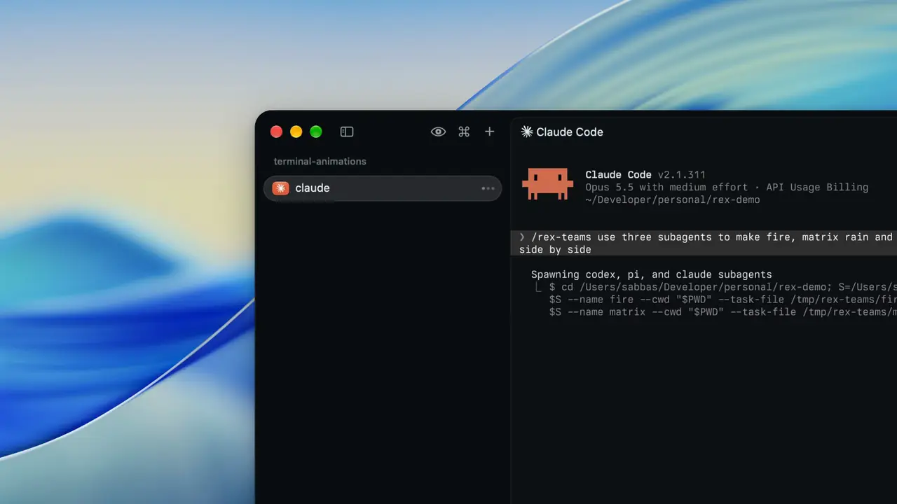

# rex-teams



A skill that lets coding agents in [Rex](https://rex.superlogical.com) start subagents and message long-running teammates.

Rex already gives agents everything this needs: tabs, `rex send`, and `rex capture`. rex-teams adds the habits on top. It sets out how a subagent reports back, and it starts every message with the command for replying. A message is typed into the other agent's terminal, which starts its next turn, so nobody polls.

I expect Rex to do this better itself one day. When it does, delete the skill.

## Install

```sh
npx skills add campfireshuffle/rex-teams -g -a claude-code -a codex -a pi
```

It needs `rex` and `jq`. Tested with Claude Code, Codex, and Pi. Other agent CLIs work as subagents too: put `{prompt}` where the CLI takes its first prompt.

Codex needs two settings in `~/.codex/config.toml`, so it can reach Rex and reply from the right tab:

```toml
[sandbox_workspace_write]
network_access = true

[features]
daemon_auto_start = false
```

## Use

Subagents. Ask your agent:

> Have Codex review this diff and Pi check the docs, then merge their findings.

Teammates. Open agents in labeled tabs or panes, tell each one who the others are, then talk to one:

```sh
rex session new crew --window team -- claude
rex block rename -s crew chief
rex split -s crew --label eng --split right -- codex
rex split -s crew --label qa  --split right -- pi
```

## Limits

- If you're typing in a pane when a message lands, the message mixes into your draft.
- A subagent that crashes before reporting wakes nobody.
- It's meant for a handful of agents you can watch.

## Remove

```sh
npx skills remove rex-teams -g
```

[MIT](LICENSE)
