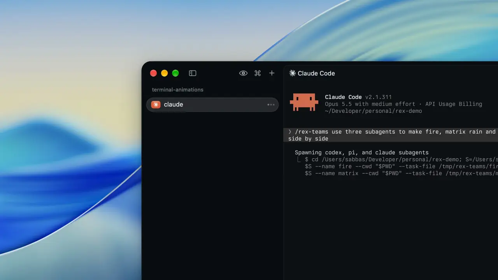

# Rex Teams



Run subagents inside Superlogical's [Rex terminal](https://rex.superlogical.com), across agent harnesses. Rex Teams lets a parent agent spawn Claude Code, Codex, Pi, OpenCode, or other agent CLIs in background tabs, receive their reports, and close completed tabs.

The skill also lets agents message long-running teammates and set one-time or recurring alarms.

This is an unofficial community skill. It isn't made by or affiliated with Superlogical, so please report bugs here, not to Rex.

> [!TIP]
> I expect Rex to do this better itself one day. When it does, delete the skill.

Rex already gives agents everything this skill needs: tabs, terminal input, and the screen. `rex-teams` adds the habits on top. It sets out how a subagent reports back, and it starts every message with the command for replying. A message is typed into the other agent's terminal, which starts its next turn, so nobody polls.

Messages are queued, and one postman per Rex host delivers them. It waits until the receiver is idle and its prompt box is empty, so it never types into your half-written prompt, and it checks that each message was submitted. [ARCHITECTURE.md](ARCHITECTURE.md) explains how.

## Install

```sh
npx skills add campfireshuffle/rex-teams
```

Requirements:
- Rex 0.1.0-preview.25 or later 
- `sha256sum` (macOS 15+ or coreutils) on macOS and Linux.

## Usage patterns

### Subagents

> /rex-teams Have Codex review this diff and Pi check the docs, then merge their findings.

### Teammates (Grok Bot style)

Open agents in labeled tabs or panes, then talk to one:

> /rex-teams Hi Chief, ask Marketer to create a launch video for my product.

> /rex-teams Ask the Builder agent on my-server to run the test suite.

> /rex-teams Send report.md to the reviewer on my-server and ask for comments.

### Set alarms

> /rex-teams Check in on the Marketer agent in 20 minutes.

> /rex-teams Every 10 minutes, check CI on my PR and stop once it's green.

## Limitations

- Messages reach Claude Code, Codex, OpenCode and Pi, which report their status to Rex and whose prompt boxes the postman can read. A message to another program waits, and its sender hears why after 10 minutes.
- A message to a busy agent waits until its turn ends.
- An agent that asks you something in plain text, rather than in a dialog, looks idle, so a message can arrive while it waits for your answer. Pi never shows a dialog, and neither do Codex and OpenCode set to approve on their own.
- If an agent's reply pushes a message off its screen before the postman sees it land, the postman may type it again, marked `resent`.
- The postman runs in a session labelled `rex-teams`. It comes back after a Rex restart only once you add the trust rule the scripts print; otherwise the next message starts it, and alarms wait until then. On Windows it doesn't come back.
- A subagent that crashes before reporting wakes nobody.
- Messages are one-way. A reply across hosts works only if the receiver's `rex hosts` can reach the sender's host.
- `spawn.lua` starts subagents only on your own host. You can message agents on other hosts and send them files, but not start them there yet ([#37](https://github.com/campfireshuffle/rex-teams/issues/37)).
- A Windows sender can't send files to another host yet.
- Short IDs that look like numbers need `--args` ([#38](https://github.com/campfireshuffle/rex-teams/issues/38)).
- Tested with Rex 0.1.0-preview.25, Claude Code 2.1.326, Codex CLI 0.172.0, Pi 1.6.0 and OpenCode 2.4.1.
